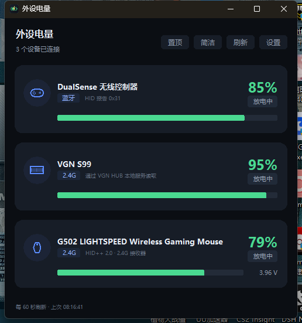
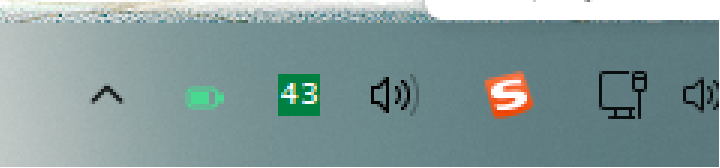
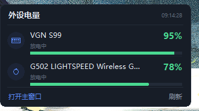
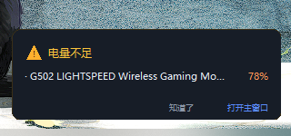

# 电力王 · PeripheralBattery

> 一个 Windows 小工具，by himlaya

一个 Windows 桌面软件，把**无线鼠标、键盘、手柄**等外设的剩余电量集中显示在一个窗口里。
支持 **2.4G 接收器**和**蓝牙**两种连接方式，后台定时刷新，不打扰前台使用。



## 功能

- **自动发现**：插入接收器或蓝牙配对后自动出现，断开后标记「已断开」并保留最后一次读数
- **多种读取协议**：罗技 HID++ 2.0、索尼手柄 HID 报告、通用无线设备识别
- **后台刷新**：默认 60 秒一次，扫描在独立线程里进行，界面不卡顿
- **充电状态**：卡片右侧用彩色标签标明「⚡ 充电中 / 放电中 / 已断开 / 不支持读取」，插线充电会立刻变绿
- **低电量弹窗**：电量低于阈值时，在托盘图标上方弹出提醒（设备名 + 剩余电量 + 「知道了 / 打开主窗口」），15 秒自动收起，同时有提示音；按 10% 档位重复提醒，插线充电后自动解除
- **托盘图标**：任务栏通知区常驻电池图标，颜色随最低电量变化；**左键直接在图标上方弹出电量面板**（不开主窗口），悬停看各设备摘要，右键菜单可刷新、置顶、开机自启、退出
- **简洁模式**：一键收成小窗口，可置顶，放在屏幕角落当仪表盘
- **只开一个窗口**：重复双击只会把已有窗口提到最前
- **开机自动启动**：设置里一键开关（写入 HKCU 的 Run 项，可随时关闭）
- **深色扁平界面**：自绘卡片、大圆角、无边框色块、胶囊形电量条与按钮、矢量设备图标、DPI 自适应
- **零第三方依赖**：打包后是独立程序，目标机器不需要装 Python

任务栏托盘里常驻的电池图标（颜色跟随最低电量）：



左键点图标，直接在托盘上方弹出电量面板，不打扰主窗口：



电量低于阈值时，会再弹一个提醒窗口（不抢键盘焦点，点「知道了」或 15 秒后自动消失）：



## 安装 / 运行

**方式一：安装包（发给别人用这个）**

双击 `dist\电力王-1.1.0-安装程序.exe`，一路「下一步」即可，和常见软件一样：

- 安装到 `C:\Program Files\PeripheralBattery`（需要点「是」通过管理员授权）
- 自动创建**桌面快捷方式**和**开始菜单**项，安装完可直接勾选启动
- 在「设置 → 应用 → 已安装的应用」里有正式的卸载入口，卸载会清干净
- 可选勾选「开机时自动启动」

**方式二：便携版（不安装）**

解压 `dist\电力王-1.1.0-便携版.zip`，双击里面的 `电力王.exe` 就能用，不写注册表、不动系统目录。

**方式三：源码运行**

需要 Python 3.10+（自带 tkinter）：

```bat
run.cmd                          :: 无控制台启动
python PeripheralBattery.pyw     :: 带控制台，方便看错误
python PeripheralBattery.pyw --probe   :: 只打印一次扫描结果
```

自己重新打包：

```bat
build.cmd                                    :: 调用 PyInstaller，产物在 dist\电力王\
ISCC.exe build\installer.iss                 :: 再生成安装包（需要装 Inno Setup 6）
```

安装包脚本在 `build\installer.iss`，中文向导语言包在 `build\lang\ChineseSimplified.isl`。

## 使用

- **点击卡片**：把「设备名 + 电量 + 连接方式」复制到剪贴板
- **置顶**：窗口保持在最前，适合放在屏幕角落
- **简洁**：切换成一行的紧凑列表
- **刷新**：立即重新扫描（快捷键 `F5`）
- **设置**：刷新间隔（15/30/60/120/300 秒）、低电量阈值、是否提示、是否弹窗、是否显示不支持读数的设备、开机自动启动、关闭窗口时是否最小化到托盘
- **托盘图标**：鼠标悬停显示「设备名 + 电量」摘要；**左键点击在图标上方弹出电量面板**（不打开主窗口，点面板里的「打开主窗口」或右键菜单才开窗口）；右键菜单为「打开主窗口 · 立即刷新 · 窗口置顶 · 开机自动启动 · 退出」。点面板外面任意位置会自动收起。窗口收进托盘后，低电量提醒会改用气泡通知

设置和窗口位置保存在 `%APPDATA%\PeripheralBattery\config.json`；万一界面报错或托盘异常，
会记到同目录的 `error.log` / `tray.log`，方便排查。

## 支持情况

| 设备类型 | 连接方式 | 读取方式 | 状态 |
| --- | --- | --- | --- |
| 罗技 G 系列（G502 LIGHTSPEED 等） | 2.4G 接收器 / 蓝牙 | HID++ 2.0 特性 `0x1004` / `0x1000` / `0x1001` | ✅ 已验证 |
| 罗技 MX / 优联系列 | Unifying 接收器 / 蓝牙 | HID++ 2.0 | ✅ 已实现 |
| DualSense（PS5 手柄） | 蓝牙 / USB | HID 报告 `0x31` / `0x01` | ✅ 已验证（蓝牙） |
| DualShock 4（PS4 手柄） | 蓝牙 / USB | HID 报告 `0x11` / `0x01` | ✅ 已实现 |
| VGN / VXE 键盘鼠标（S99、V98 Pro、VXE75 等） | 2.4G 接收器 | 借道 VGN HUB 的本地服务（需安装并运行 VGN HUB） | ✅ 已验证（S99：95%） |
| 其他无线键鼠 / 耳机 | 2.4G / 蓝牙 | 厂商私有协议 | ⚠️ 会显示设备卡片并标注「未获取到电量数据」 |

> 只要能读到电量，卡片上会同时给出**百分比**和**电压（V）**；读不到时不会编造数字，而是明确标注。

## 电量是怎么读到的

- **罗技**：通过 HID++ 2.0 在厂商 HID 集合（usage page `0xFF00`）上查询。接收器把最多 6 个配对设备挂在索引 `0x01..0x06` 上，蓝牙直连设备用 `0xFF`。
  G 系列鼠标只实现了已废弃的 `0x1001`，它返回**大端毫伏值 + 充电标志**，所以百分比是按锂电放电曲线换算的，和 G HUB 显示可能差几个百分点（卡片右下角同时给出了电压原值）。
- **索尼手柄**：电量在输入报告里。DualSense 蓝牙报告 `0x31` 第 54 字节、USB 报告 `0x01` 第 53 字节；低 4 位是电量档位（1 档 = 10%），高 4 位是充电状态，与 Linux `hid-playstation` 驱动的解析一致。
- **VGN / VXE**：这类键盘把电量命令锁在厂商私有协议里，HID 层抓不到（实测抓包只有配置区读取），协议实现在官方 `game-power-service.exe`（原生）内部。但官方软件会对本地 HTTP 服务发起 `POST /<型号>` 调用，所以本程序在检测到 VGN HUB 的服务时，直接向它请求 `get_device_power_info` 拿原始电量，再按官方同样的规则（取最近的 5%）换算 —— 因此显示值与 VGN HUB 完全一致。**前提是 VGN HUB 正在运行**；没运行时该设备会退回「未获取到电量数据」。
- **其他设备**：列出设备并标注不支持，方便区分「没检测到」和「读不出来」。

## 目录结构

```
PeripheralBattery/
├─ 安装.cmd / 卸载.cmd        安装、卸载（调用对应 .ps1）
├─ build.cmd                  重新打包 exe
├─ run.cmd                    源码方式启动
├─ PeripheralBattery.pyw      程序入口（--probe 为命令行模式）
├─ app/
│  ├─ hid.py                  ctypes 封装的 HID 枚举与读写（含设备树查询）
│  ├─ logitech.py             罗技 HID++ 2.0 协议
│  ├─ sony.py                 索尼手柄 HID 报告
│  ├─ unknown.py              未支持设备的识别
│  ├─ monitor.py              后台扫描线程与状态合并
│  ├─ model.py                Device 数据模型
│  ├─ config.py               配置读写
│  ├─ shell.py                单实例、开机自启、窗口激活
│  ├─ tray.py                 托盘图标（ctypes + Shell_NotifyIcon，无第三方库）
│  ├─ alert.py                低电量弹窗
│  └─ ui.py                   Tkinter 界面
├─ assets/                    图标与截图
├─ build/                     PyInstaller 配置（version_info.txt、spec）
├─ dist/
│  ├─ 电力王/               打包产物（电力王.exe + _internal）
│  └─ 电力王-1.1.0-便携版.zip
└─ tools/                     开发用探针脚本（不参与运行）
```

## 扩展新设备

1. 在 `app/` 下新建 `xxx.py`，提供 `scan(existing=None) -> list[Device]`；
2. 用 `app.hid.enumerate_devices()` 找到目标设备，读原始报文；
3. 返回 `Device(uid=..., name=..., kind=..., link=..., percent=...)`；
4. 在 `app/monitor.py` 的 `PROVIDERS` 里注册。

`tools/probe_dongle.py` 是给未知 2.4G 接收器试协议的探针，`tools/preview.py` 可以用假数据预览界面效果。

## 已知限制

- VGN / VXE 设备依赖官方 VGN HUB 的后台服务：VGN HUB 退出后，电量会显示为「未获取到电量数据」（不会给出过期数字）。
- 手柄休眠后不再发送 HID 报告，需要按一下按键唤醒才能更新读数。
- 罗技设备如果被 G HUB 同时占用，偶尔会有一两次查询超时，下一轮刷新会自动恢复。
- 只支持 Windows（依赖 SetupAPI / HID / 注册表接口）。
- Windows 11 默认把新托盘图标塞进「隐藏的图标」里，本程序启动时会把自己的条目标记为常显（写 `HKCU\Control Panel\NotifyIconSettings` 的 `IsPromoted`）并重新注册一次，所以图标会直接出现在任务栏。如果系统把它又收回去了，在「设置 → 个性化 → 任务栏 → 系统托盘图标」里打开「电力王」即可。
- exe 没有代码签名，首次运行 SmartScreen 可能提示「未知发布者」，选「仍要运行」即可。
